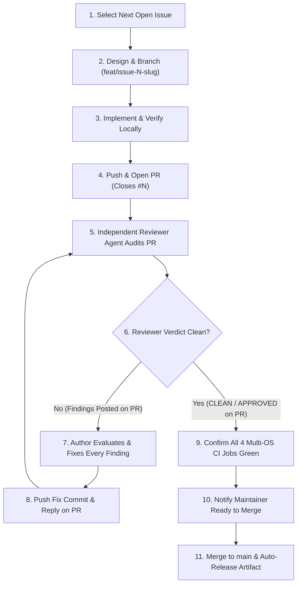

# OryqDB Continuous Issue-to-PR Workflow

OryqDB follows a disciplined, issue-driven engineering loop with **mandatory multi-round independent agent code review and explicit sign-off agreement** before any PR is recommended for merge into `main`.

## Workflow Loop (One Issue at a Time)

### Step-by-Step Rules
1. **Pick One Issue:** Select the next open issue in strict milestone order (`v0.9.x` → `v0.10.x` → `v0.11.x`) and create a dedicated branch `feat/issue-<N>-<slug>` from `main`.
2. **Design Before Coding:** Verify module ownership (`architecture/modules.toml`), dependency allowlists, and contract changes (`architecture/contract-changes.toml`) before editing.
3. **Implement & Verify Locally:** Run `cargo fmt --all -- --check`, `cargo clippy --workspace --all-targets -- -D warnings`, `cargo test --workspace`, `cargo test --workspace --no-default-features`, `cargo run -p xtask -- architecture --base origin/main`, `python3 tools/validate_design_docs.py`, and Miri/C99 checks where applicable.
4. **Open PR:** Push the branch and open a PR targeting `main` with `Closes #<N>` in the body.
5. **Independent Reviewer Agent (Round 1):** Launch a fresh, independent reviewer agent with zero implementation bias to inspect `git diff origin/main...HEAD` for bugs, concurrency/safety hazards, edge cases, cross-OS portability (Linux/macOS/Windows), and missing tests. The reviewer posts structured findings (`[MUST-FIX]`, `[SHOULD-FIX]`, `[NIT]`) directly on the PR via `gh pr comment` and notifies the coordinator.
6. **Author Fix & Reply:** The implementing agent inspects every review comment, fixes all valid findings, adds regression tests, pushes the fix commit(s), and replies on the PR citing the commit SHA.
7. **Mandatory Re-Review Round (Convergence Gate):** After fixes are pushed, the coordinator **re-triggers the Independent Reviewer Agent** to re-audit the updated diff and verify that every prior finding is genuinely resolved with zero new regressions. Repeat Steps 6–7 until the Independent Reviewer Agent posts **`APPROVED / CLEAN — Ready for Merge`** on the PR and both agents agree.
8. **Green Multi-OS CI & Handoff:** Only after **both** the Independent Reviewer Agent's clean sign-off **and** all 4 CI jobs (`Format/Clippy/Arch/Docs`, `ubuntu-latest`, `macos-latest`, `windows-latest`) are green is the maintainer notified to merge. Merging to `main` automatically publishes the new `v0.x.y` GitHub Pre-Release via `.github/workflows/release.yml`.
