# OryqDB Continuous Issue-to-PR Workflow

OryqDB follows a disciplined, issue-driven engineering loop with **mandatory independent agent code review** before any PR is merged into `main`.

## Workflow Loop (One Issue at a Time)

```mermaid
flowchart LR
    A["1. Select Next Open Issue"] --> B["2. Design & Branch"]
    B --> C["3. Implement & Verify Locally"]
    C --> D["4. Push & Open PR (Closes #N)"]
    D --> E["5. Independent Reviewer Agent Audits PR"]
    E --> F["6. Post Review Comment on PR"]
    F --> G["7. Author Evaluates & Fixes Findings"]
    G --> H["8. Reply on PR & Verify Green Multi-OS CI"]
    H --> I["9. Human Review & Merge to main"]
    I --> J["10. Auto-Release Pre-Release Artifact"]
```

### Step-by-Step Rules
1. **Pick One Issue:** Select the next open issue in strict milestone order (`v0.9.x` → `v0.10.x` → `v0.11.x`) and create a dedicated branch `feat/issue-<N>-<slug>` from `main`.
2. **Design Before Coding:** Verify module ownership (`architecture/modules.toml`), dependency allowlists, and contract changes (`architecture/contract-changes.toml`) before editing.
3. **Implement & Verify Locally:** Run `cargo fmt --all -- --check`, `cargo clippy --workspace --all-targets -- -D warnings`, `cargo test --workspace`, `cargo test --workspace --no-default-features`, `cargo run -p xtask -- architecture --base origin/main`, and `python3 tools/validate_design_docs.py`.
4. **Open PR:** Push the branch and open a PR targeting `main` with `Closes #<N>` in the body.
5. **Independent Reviewer Agent:** Launch a separate, fresh reviewer agent with no implementation bias to inspect the PR diff (`git diff origin/main...HEAD`) for bugs, concurrency/safety hazards, edge cases, cross-OS portability (Linux/macOS/Windows), and missing tests.
6. **Public PR Review Comment:** Post the independent reviewer's structured findings directly on the PR via `gh pr comment`.
7. **Address Review Feedback:** The implementing agent evaluates every finding, fixes valid issues, adds regression tests, pushes the fix commit(s), and posts a follow-up PR comment referencing each fix.
8. **Green Multi-OS CI & Merge:** Wait for all 4 CI jobs (`Format/Clippy/Arch/Docs`, `ubuntu-latest`, `macos-latest`, `windows-latest`) to pass before the maintainer merges. Merging to `main` automatically builds and publishes the new `v0.x.y` GitHub Pre-Release via `.github/workflows/release.yml`.
