# OryqDB Implementation Roadmap & Phased Milestone Plan

* **Author:** Ayesh Rodrigo (@ayeshrodz, https://github.com/ayeshrodz)
* **Date:** 2026-11-18
* **Master Design Reference:** [docs/designs/oryqdb.md](./designs/oryqdb.md)

* **Last Reviewed:** 2026-11-19

---

## Module Execution Map

[MODULE_DEVELOPMENT_PLAN.md](MODULE_DEVELOPMENT_PLAN.md) refines these product milestones into ordered work packages with prerequisite ports, owned files, tests and a result ledger. [modular-architecture.md](designs/modular-architecture.md) owns source placement; older core-relative paths in this roadmap are historical scope labels. Product milestones and extension acceptance remain defined here. W07 supplies the primary mapping required for M3 CRUD before M4 secondary-index completion; W14 supplies core integrity before CLI delivery.

## Phased Execution Strategy

To honor the incremental engineering discipline of [docs/draft-spec.md](./draft-spec.md) while delivering the full OryqDB architecture without breaking file-format migrations, execution is organized into **3 sequential phases across Milestones 0–10**. All on-disk header bitmasks (`required_read_features`, `required_write_features`), 16-byte slotted directory layouts (including `field_bloom_mask: u64` and `head_delta_slot: u16`), and core trait boundaries (`StorageIo`, `RecordCompactor`, `SnapshotCoordinator`, `PluggableIndex`) are proposed in Phase 1 as reviewed drafts. Golden fixtures and schema gates must pass before freezing v1; extension bitmasks do not prove that an unfrozen layout will remain compatible.

```mermaid
flowchart LR
    subgraph Phase1["Phase 1: Research & Core Transactional Engine (M0 - M6)"]
        M0["M0: LiteDB Audit & Specs"] --> M1["M1: Slotted Pager & VFS"]
        M1 --> M2["M2: Logical-Page WAL & MVCC"]
        M2 --> M3["M3: OryqDoc & Collections"]
        M3 --> M4["M4: Primary & Secondary Indexes"]
        M4 --> M5["M5: Streaming Query Engine"]
        M5 --> M6["M6: Panic-Safe C ABI (oryq_*)"]
    end
    subgraph Phase2["Phase 2: Deltas, Compound/Array Indexes, Pipelines & CLI (M7 - M9)"]
        M6 --> M7["M7: State-Normalized Deltas & Benchmarks"]
        M7 --> M8["M8: Compound (R=16), Multi-Key & Aggregation"]
        M8 --> M9["M9: oryq CLI & Online Backup"]
    end
    subgraph Phase3["Phase 3: Baseline Release Candidate (M10)"]
        M9 --> M10["M10: Baseline Release Candidate"]
    end
```

---

## Phase 1: Research & Core Transactional Engine (Milestones 0–6)

### Milestone 0 — Research & Architecture Baseline
* **Deliverables:**
  * Clone `https://github.com/litedb-org/LiteDB.git` into `references/LiteDB` and record the analyzed commit SHA.
  * Complete all 9 research reports in `docs/research/` (`litedb-architecture.md`, `litedb-feature-inventory.md`, `litedb-storage-analysis.md`, `litedb-query-analysis.md`, `litedb-concurrency-analysis.md`, `litedb-performance-analysis.md`, `competitor-comparison.md`, `architecture-decisions.md`, `implementation-roadmap.md`).
  * Complete the 8 subsystem specifications in `docs/` (`architecture.md`, `file-format.md`, `document-model.md`, `transactions.md`, `indexing.md`, `query-language.md`, `ffi.md`, `compatibility.md`) and the 5 living trackers (`PROJECT_STATUS.md`, `ROADMAP.md`, `KNOWN_ISSUES.md`, `ARCHITECTURE_DECISIONS.md`, `BENCHMARK_RESULTS.md`).
* **Acceptance Criteria:**
  * Every claim in the LiteDB analysis cites specific C# source files and commit SHA.
  * All 8 subsystem specifications adhere to the 10-section standard, with review findings dispositioned and missing catalog/golden fixtures explicitly assigned to subsequent gates. M0 remains open until source research is complete.

### Milestone 1 — Persistent Slotted-Page Foundation
* **Deliverables:**
  * Eight-crate baseline workspace per the modular specification (types, document, engine, index, query, core, FFI, CLI), `rustfmt.toml`, `.clippy.toml`, and CI workflow.
  * `StorageIo` VFS trait (`OsStorageIo` + `FaultInjectingStorageIo`) and `storage/pal.rs` (OS locks + process-global `(st_dev, st_ino)` registry + platform data sync).
  * Page 0 dual shadow headers (`0..256` and `256..512`) with XXH3-64 checksum verification and `header_generation` selection.
  * 8192-byte slotted page manager (`page.rs`), trunk/leaf freelist allocator (`freelist.rs`), and linked overflow payload page chains (`overflow.rs`).
* **Acceptance Criteria:**
  * Real `.oryq` files persist allocated slotted pages and overflow chains across process restarts.
  * Corrupted magic bytes, out-of-bounds slot offsets, or bit-flipped page payloads return structured `OryqError::Corruption(CorruptionError)`.

### Milestone 2 — Logical-Page B+ Tree, `.oryq-wal` & Single-Process MVCC
* **Deliverables:**
  * Logical-page B+ tree (`btree.rs`) with leaf/internal splits and merges.
  * Sharded Clock-Pro bounded buffer pool (`buffer_pool.rs`) with RAII `PageGuard` pinning and `PageVersionIndirectionMap` (`version_map.rs`).
  * `.oryq-wal` writer/reader (`FullPageFrame`, `CommitFrame` with chained XXH3-64 checksums; reserve and reject delta frames until M7), checkpoint copy-back, and startup crash recovery (`recovery.rs`).
  * `SingleProcessCoordinator` (connection-lifetime exclusive OS lock, mutex-protected snapshot admission, per-transaction reader tokens) and one-sync serialized explicit write transactions; queued-command group commit is E3.
* **Acceptance Criteria:**
  * Committed transactions survive process termination and reopen; rolled-back and uncommitted WAL frames are invisible after recovery.
  * Subprocess fault-injection harness passes all 7 critical failure points from `docs/draft-spec.md` Section 10.

### Milestone 3 — `OryqDoc` Binary Format & Document Collections
* **Deliverables:**
  * `OryqDoc` v1 encoder (`OryqDocBuf`) and zero-copy reader (`OryqDocView<'a>`) with 12-byte sorted field-offset directory ($O(\log k)$ binary search) and unaligned-safe scalar decoding.
  * Lossless JSON and Extended-JSON (`$oid`, `$date`, `$binary`, `$uuid`, `$numberDecimal`) conversion.
  * Collection catalog B+ tree and CRUD operations (`insert`, `get_by_id`, `replace`, `delete`, and `$set`, `$unset`, `$inc`).
* **Acceptance Criteria:**
  * Arbitrary nested documents and arrays survive persistence and reopen with bit-identical round-trip fidelity.
  * `cargo +nightly miri test` passes on `OryqDocView` field extraction across all byte alignments.

### Milestone 4 — Primary & Single/Nested-Field Secondary Indexes
* **Deliverables:**
  * Order-preserving memcomparable key codec (`key_codec.rs`) covering all `OryqTypeTag` variants (including exact variable-width cross-type numeric encoding).
  * Transactional primary `_id` B+ tree index and secondary B+ tree indexes on top-level and dotted nested paths (`"profile.country"`).
  * Unique constraint enforcement (`OryqError::DuplicateKey`) and atomic index maintenance across inserts, updates, deletes, and rollbacks.
* **Acceptance Criteria:**
  * Indexed equality and range lookups match full collection scan results under `proptest` randomized workloads.
  * Fault-injected crashes during index creation or multi-index document updates recover with 100% index-to-document consistency.

### Milestone 5 — Streaming Query Engine & Planner
* **Deliverables:**
  * Filter AST (`$eq`, `$ne`, `$gt`, `$gte`, `$lt`, `$lte`, `$and`, `$or`, `$in`, `$nin`, `$exists`, `$not`), rule-based access-path planner (`planner.rs`), and `explain()` / `explain_analyze()`.
  * Step-unpinning streaming `Cursor<'tx>` yielding zero-copy `OryqDocView<'_>` (pinning at most 1 leaf page frame at a time), projection, sorting (including top-$K$ bounded heap coalescing), limit, skip, and `count()`.
* **Acceptance Criteria:**
  * Queries over collections larger than `max_cache_bytes` stream to completion without exceeding the buffer-pool memory ceiling.
  * `explain_analyze()` accurately reports the chosen index and scan counters.

### Milestone 6 — Panic-Safe C ABI (`include/oryq.h`)
* **Deliverables:**
  * `crates/oryq-ffi` producing `liboryq.so`, `liboryq.a`, `oryq.dll`, `liboryq.dylib` and `include/oryq.h`.
  * Opaque handles (`oryq_db_t`, `oryq_txn_t`, `oryq_cursor_t`, `oryq_doc_t`), `catch_unwind` panic containment, thread-local error messages, JSON CRUD entrypoints, and zero-copy cursor field getters (`oryq_cursor_get_utf8`, `oryq_cursor_get_i64`, `oryq_cursor_get_f64`, `oryq_cursor_get_bool`).
  * Native C integration tests (`crates/oryq-ffi/tests/c/api.c` and `crates/oryq-ffi/tests/c/lifecycle.c`).
* **Acceptance Criteria:**
  * Native C integration program compiles without warnings (`-Wall -Wextra -Werror`), passes CRUD and reopen persistence checks under AddressSanitizer/Valgrind, and verifies that synthetic Rust panics return `ORYQ_ERR_INTERNAL_PANIC` without unwinding into C.

---

## Phase 2: State-Normalized Deltas, Compound/Array Indexes, Aggregation & CLI (Milestones 7–9)

### Milestone 7 — State-Normalized Slotted-Page Deltas & Comparative Benchmark Suite
* **Deliverables:**
  * Slotted-page state-normalized delta patches (`$set`, `$unset`, `$inc`, `$push`, `$pull`), 64-bit 2-hash `field_bloom_mask` in 16-byte slot directory entries, `SlotDeltaFrame` WAL logging, and eager in-page consolidation at `MAX_DELTA_CHAIN = 4` via `RecordCompactor`.
  * Reproducible benchmark suite (`benchmarks/`) measuring throughput, p50/p95/p99 latency, peak RAM, file size, and write amplification against SQLite, SQLite + JSONB, LiteDB, and `redb`.
* **Acceptance Criteria:**
  * Partial updates on non-indexed fields avoid rewriting the base `OryqDoc` up to `MAX_DELTA_CHAIN = 4`, and unmodified field reads bypass delta inspection in $O(1)$ via the 64-bit bloom bitmask.
  * Benchmark methodology and comparative measurements are recorded in `docs/BENCHMARK_RESULTS.md`.

### Milestone 8 — Prefix-Compressed Compound Indexes, Multi-Key Indexes, Aggregation & Portability
* **Deliverables:**
  * Prefix-compressed compound index leaf pages with $R = 16$ uncompressed Restart Points (`compound.rs`).
  * Multi-key array element indexing (`multikey.rs`) with parallel-array compound guard (`ORYQ_ERR_PARALLEL_ARRAY_INDEX`), `$elemMatch`, and `RoaringTreemap` cursor deduplication.
  * Streaming and spillable aggregation pipeline (`$match`, `$project`, `$group`, `$sort`, `$limit`, `$skip`, `$unwind`, snapshot-consistent `$lookup`) bounded by `max_query_memory_bytes`.
  * Core `Database::integrity_check()` API and test harness (CLI exposure follows in M9).
  * Cross-platform CI and golden file portability verification across Linux, Windows, and macOS (x86-64 and ARM64).
* **Acceptance Criteria:**
  * Compound and multi-key index queries pass differential oracle tests and crash-recovery checks.
  * `.oryq` golden database fixtures created on Linux open and pass the core integrity test harness on Windows and macOS.

### Milestone 9 — `oryq` CLI, Forensic Inspection & Online Backup
* **Deliverables:**
  * `crates/oryq-cli` (`oryq` binary) implementing `info [--stats]`, `collections`, `collection create|drop`, `insert`, `find`, `aggregate`, `indexes`, `backup`, `version`, and forensic subcommands (`integrity-check [--verbose]`, `page-inspect`, `wal-inspect`, `inspect-locks`).
  * Snapshot-consistent online `Database::backup_to()` with full checksum verification on the destination file.
* **Acceptance Criteria:**
  * `oryq integrity-check` detects injected structural/checksum corruption. In-process `Database::backup_to()` produces a verified standalone file while writer threads run in that owning process. The separate `oryq backup` CLI requires exclusive access in SingleProcess mode; live cross-process CLI access waits for E2.

---

## Phase 3: Baseline Release Candidate (Milestone 10)

### Milestone 10 — Core Release Candidate
* **Deliverables:**
  * Freeze baseline persistent formats only after byte fixtures and independent ordering/recovery oracles pass.
  * Complete multi-OS native tests, C ABI/header compatibility checks, fuzzing, Miri/ASan/TSan where supported, license audit, source-attribution review and release packaging.
  * Document actual tested platforms, durability policies and remaining limitations; cross-compilation alone is not native verification.
* **Acceptance Criteria:**
  * All baseline M0–M9 gates pass with recorded results, crash/recovery schedules include checkpoint and reset sync boundaries, and no unresolved baseline Blocker/Major finding remains.
  * Optional search and multi-process extensions are disabled and return `UnsupportedFeature` until their separate gates pass. They do not delay the baseline release.

## Post-Baseline Extensions (Separate Acceptance)

* **E1 — Search:** Finalize `PluggableIndex` registration/dependency direction, snapshot-visible pending/merged search, deletion handling, feature masks and WAL recovery; then implement FTS/vector crates. Provider interfaces/context are owned by oryq-index. Provider crates depend only on types/document/engine/index; oryq-core hosts one optional provider registration and Cargo edge. FFI/CLI consume that core composition and providers never depend on core.
* **E2 — Shared processes:** Freeze the cross-process synchronization ABI only after admission/publication/reset and owner-death protocols pass native subprocess tests on each supported OS. Until then, `SharedMultiProcess` returns `UnsupportedFeature`.
* **E3 — Group commit:** Enable queued-command batching only after the writer dependency and failed-sync tests in transactions.md pass; explicit transactions retain one-sync commit semantics.

## Review-Driven Acceptance Matrix

| Gate | Milestone | Required evidence |
| :--- | :--- | :--- |
| Storage interoperability | M1–M3 | Header/page/WAL/catalog fixtures, overflow/freelist bounds/cycles, parser depth and allocation limits |
| Transaction safety | M2 | Pause at reader admission and guard release; crash after every checkpoint/reset write/sync; uncertain commit faults; restart recovery twice |
| Document semantics | M3/M7 | `_id` immutability; numeric overflow/precision; ancestor replacement/unset and chained updates; owned overflow/raw export |
| Index completeness | M4/M8 | Exact rational ordering oracle; sparse/Missing/Null/negative predicates; empty/nested arrays; identity uniqueness; prefix compression fixtures |
| Query bounds | M5/M8 | Shared stage accounting, bitmap limits, oversized top-K/join/group, spill exhaustion, cancellation/error cleanup |
| FFI lifecycle | M6 | Extract header compiles as C/C++; database close with children; BUSY completion; transaction close; NULL/open diagnostics; failed commit and panic fallback |
| Delivery coherence | M8–M10 | Core integrity API by M8; offline CLI versus in-process online backup; native platform results, no assumed measurements |
