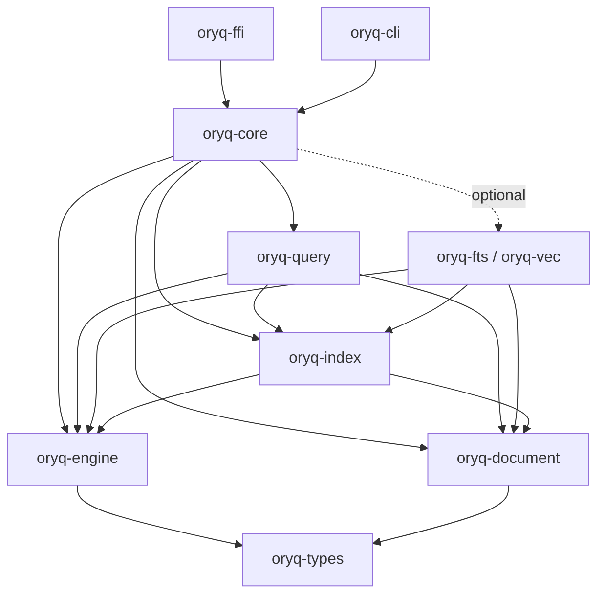

# OryqDB Modular Technical Specification

* **Author:** Ayesh Rodrigo (@ayeshrodz)
* **Status:** Reviewed draft (converged after 5 EGM review rounds); design only, no Rust implementation exists
* **Date:** 2026-11-19
* **Predecessor:** [Reviewed engine design](oryqdb.md)

**Review evidence:** [EGM findings and dispositions](../reviews/modular-architecture/goldfish_review_report.md).

## Overview

Organize OryqDB into eight baseline production crates, two optional search crates, and feature folders within their owning crate. Each capability has one implementation owner, one public boundary and a local test suite. `oryq-core` remains the application-facing crate; applications do not assemble storage internals themselves.

This specification owns source placement, allowed dependencies, feature registration and change boundaries. Existing subsystem specifications continue to own observable behavior and persistent bytes. The [delivery plan](../MODULE_DEVELOPMENT_PLAN.md) owns module work packages; [ROADMAP.md](../ROADMAP.md) retains M0–M10 and E1–E3 product acceptance gates. File paths in the older master implementation manifest are superseded by the ownership map here. This changes source organization, not the reviewed WAL/MVCC, query or C ABI guarantees.

## The Problem

A folder split alone permits any component to import another component's internals. Feature-specific branches then spread through parsing, planning, updates, WAL, configuration, FFI and CLI. Removing a feature leaves hidden calls or persisted state its replacement cannot maintain.

The required boundary is a set of enforceable contracts, not a promise that every change fits in one file. An internal algorithm change should stay within its module. Adding an implementation to an existing extension point should touch its feature folder and one registration entry. Changing an external API, shared contract or persistent format legitimately involves its owner and affected consumers; those changes require an explicit dependency and migration review.

## Goals

* Make production dependency cycles impossible through crate-level dependencies and restricted public exports.
* Keep normal feature edits within one owner folder, its tests/specification and, when needed, one composition entry.
* Keep storage code independent of document values, query operators and optional search algorithms.
* Provide explicit registration points for update operators, query stages, index providers, coordination providers and CLI commands.
* Build and test each module independently before integrating a runnable vertical slice.
* Distinguish disabling behavior, excluding compiled code, removing persistent objects and changing a persistent format.
* Preserve one stable Rust facade and the reviewed stable C symbol/status contracts.

## Non-Goals

Runtime loading of native shared-library plugins, a stable Rust plugin ABI, arbitrary untrusted third-party code, independent versioning of internal crates, hot removal while transactions are active, and making foundational durability/format changes local to a single feature are outside this design. Optional Rust implementations are statically linked and trusted. The baseline still needs the source audit and runtime evidence recorded in the roadmap.

## Critical User Journeys

### Change one query operator

**Given:** `$group` is implemented in the query module. **When:** its spill strategy changes without changing semantics. **Then:** edit `oryq-query/src/stages/group/` and its colocated tests/spec; keep core, storage, FFI and CLI unchanged. Run query contract tests and the aggregation integration selection.

### Add a new index implementation

**Given:** a new implementation fits `IndexProvider`. **When:** it is registered. **Then:** its crate/folder owns extraction, writes, reads, drop and validation; one core composition entry connects it. The planner uses provider capabilities rather than an exhaustive feature enum. The provider passes the shared index conformance suite before use.

### Remove an optional persisted feature

**Given:** a database contains vector indexes. **When:** the application wants a vector-free build. **Then:** use a capable build to drain/drop the indexes transactionally, verify the latest catalog requirements, checkpoint if producing a standalone file, and only then exclude the provider. A reduced build opened too early may read baseline data but rejects affected writes/schema changes and vector queries. It never silently skips maintenance.

## Technical Plan

### 1. Dependency Graph

Arrows mean “imports.” Only direct production dependencies listed in this table are allowed. All internal crates use the workspace release version. Core re-exports supported application types; internal crate APIs have no separate stability promise.

| Crate | Direct internal production dependencies | Owns |
| :--- | :--- | :--- |
| `oryq-types` | none | IDs, error envelope, memory reservations, cancellation and capability identifiers |
| `oryq-document` | types | OryqDoc, exact value comparison, paths, JSON conversion and update evaluation |
| `oryq-engine` | types | VFS/platform I/O, pages/trees, WAL, cache, physical transactions, snapshots, recovery and checkpoint |
| `oryq-index` | types, document, engine | Key codec, index descriptors/providers, primary/secondary/compound/multikey indexes |
| `oryq-query` | types, document, engine, index | Filter parsing, planning, scans, stages, spill and explain |
| `oryq-core` | types, document, engine, index, query; optional fts/vec | Public facade, database catalog, collection operations, write orchestration and composition |
| `oryq-ffi` | core only | C handles, ownership checks, status mapping, diagnostics and generated header |
| `oryq-cli` | core only | Command parsing, output rendering and CLI workflows |
| `oryq-fts` / `oryq-vec` (E1) | types, document, engine, index; no core/query dependency | Provider implementation and provider-local options/data formats |



The table is the complete dependency allowlist; the diagram omits some edges to types for readability. No crate may depend on FFI/CLI. Engine may not import document/index/query/core, including through a convenience helper crate. Document does not need an engine to parse or compare bytes. Core is the single composition root and optional-provider host; providers never depend back on core.

### 2. Proposed File Structure

All paths below are planned, not existing implementation. The ownership catalog and module guides enumerate the files to create and their purposes. Source tests live with their owner; only cross-module behavior belongs in core integration tests.

```text
Cargo.toml                         # explicit workspace members and shared versions
Cargo.lock
rustfmt.toml
.clippy.toml
architecture/
  modules.toml                     # dependency, ownership and feature allowlist
  capabilities.toml                # stable IDs and persistent feature-bit allocation
  contract-changes.toml             # append-only shared-contract change notes
.github/workflows/ci.yml
crates/
  oryq-types/
    Cargo.toml, README.md
    src/{lib,ids,error,budget,cancel,capability}.rs
    tests/{budget,identity,errors}.rs
  oryq-document/
    Cargo.toml, README.md
    src/{lib,types,codec,view,array,path,json,compare}.rs
    src/updates/{mod,registry,set,unset,inc,push,pull}.rs
    src/patch/{mod,normalize,resolve,compact}.rs
    tests/{roundtrip,ordering,updates,malformed}.rs
    tests/fixtures/README.md
  oryq-engine/
    Cargo.toml, README.md
    src/{lib,config,ports,inspect}.rs
    src/io/{mod,vfs,registry}.rs
    src/io/platform/{mod,unix,windows}.rs
    src/format/{mod,header,page,wal}.rs
    src/pager/{mod,allocator,freelist,overflow,guard}.rs
    src/btree/{mod,search,insert,delete,cursor,layout}.rs
    src/cache/{mod,pool,versions}.rs
    src/transaction/{mod,read,write,savepoint,publish}.rs
    src/coordinator/{mod,single_process}.rs
    src/coordinator/shared_process/{mod,admission,locks,recovery}.rs  # E2 only
    src/commit_batch/{mod,queue,leader}.rs                         # E3 only
    src/recovery/{mod,scan,replay}.rs
    src/checkpoint/{mod,copy,reset,seal}.rs
    tests/{persistence,recovery,admission,checkpoint,locking}.rs
    tests/support/{mod,fault_io,crash_process}.rs
    tests/fixtures/README.md
  oryq-index/
    Cargo.toml, README.md
    src/{lib,descriptor,key_codec,registry,provider,maintenance}.rs
    src/primary/{mod,read,write}.rs
    src/secondary/{mod,extract,read,write}.rs
    src/compound/{mod,keys,bounds}.rs
    src/multikey/{mod,extract,dedup}.rs
    src/plugin/{mod,context,pending}.rs
    tests/{codec,conformance,uniqueness,completeness}.rs
  oryq-query/
    Cargo.toml, README.md
    src/{lib,ports,context,ast,parse,cursor,explain}.rs
    src/predicates/{mod,registry,comparison,logical,array,string}.rs
    src/planner/{mod,capabilities,bounds,rank}.rs
    src/stages/{mod,registry,match_stage,project,limit,skip,unwind,lookup}.rs
    src/stages/sort/{mod,heap,external}.rs
    src/stages/group/{mod,accumulator,partition}.rs
    src/spill/{mod,files,quota,cleanup}.rs
    tests/{filters,planner,pipeline,budget,spill}.rs
  oryq-core/
    Cargo.toml, README.md
    src/{lib,database,config,error,stats}.rs
    src/api/{mod,collection,read,write,cursor}.rs
    src/catalog/{mod,collection,index,capabilities,codec}.rs
    src/write/{mod,statement,mutation,maintenance}.rs
    src/composition/{mod,builtins,providers,options}.rs
    src/adapters/{mod,record_compactor,query_source}.rs
    src/admin/{mod,integrity,backup,inspect}.rs
    tests/{vertical_slice,atomic_maintenance,feature_lifecycle,backup}.rs
  oryq-ffi/
    Cargo.toml, README.md, build.rs
    src/{lib,guard,status,diagnostics}.rs
    src/handles/{mod,database,transaction,cursor,document}.rs
    src/api/{mod,database,collection,transaction,document,cursor,admin}.rs
    tests/{header,lifecycle,panic}.rs
    tests/c/{api,lifecycle}.c
  oryq-cli/
    Cargo.toml, README.md
    src/{main,app,output}.rs
    src/commands/{mod,registry,info,collections,crud,indexes,backup,integrity,inspect}.rs
    tests/{commands,locking,output}.rs
  oryq-fts/                        # E1, not a baseline workspace member
    Cargo.toml, README.md
    src/{lib,descriptor,provider,tokenizer,postings,bm25,options}.rs
    tests/{conformance,visibility,removal}.rs
  oryq-vec/                        # E1, not a baseline workspace member
    Cargo.toml, README.md
    src/{lib,descriptor,provider,distance,graph,options}.rs
    tests/{conformance,visibility,removal}.rs
include/oryq.h                    # generated, FFI owns stable signatures
xtask/
  Cargo.toml
  src/{main,architecture,module_checks,header,fixtures}.rs
fuzz/
  Cargo.toml
  fuzz_targets/{document,page,wal,query,ffi}.rs
benchmarks/
  Cargo.toml
  src/{main,datasets,durability,report}.rs
  src/workloads/{mod,insert,lookup,update,index,pipeline,concurrency,recovery}.rs
```

`mod.rs` declares a boundary and re-exports its supported items; it must not become a shared implementation dump. A new stage with multiple files receives its own directory, as sort/group do. `src/lib.rs` exports only documented ports; implementations remain private. Reaching into sibling crate paths with `#[path]`, source inclusion or file reads to bypass visibility is prohibited.

### 3. Ownership and Existing-Path Mapping

| Previous master path / concern | Canonical owner after this spec | Contract guide |
| :--- | :--- | :--- |
| core `error.rs`, IDs and shared budget concepts | types; core translates to its public error facade | [Foundation](../modules/foundation.md) |
| core `document/` | document | [Documents](../modules/document.md) |
| core `storage/`, `cache/`, physical `transaction/` | engine | [Engine](../modules/engine.md) |
| Collection transaction methods and database-level catalog | core API/catalog/write; wraps engine transaction | [Core](../modules/core.md) |
| core `index/` | index | [Indexes](../modules/index.md) |
| core `query/` | query | [Queries](../modules/query.md) |
| core transaction `backup.rs` | core admin backup; engine exposes snapshot page traversal | [Core](../modules/core.md) |
| FFI and CLI | existing adapters, business logic stays in core | [Adapters](../modules/adapters.md) |
| Optional search / shared coordination / batching | provider crates / engine-local provider folders | [Extensions](../modules/extensions.md) |

The original `ReadTransaction.collection()` API remains a core wrapper over an engine byte-transaction. Engine transactions do not acquire collection or document methods. Engine's catalog-root field is an opaque page ID; core owns collection/index catalog serialization. Index owns its provider-specific descriptor/options schema. Physical format bytes remain defined by [file-format.md](../file-format.md), regardless of source placement.

### 4. Boundary Contracts

The following are contract descriptions, not implementation code or a stable external Rust ABI. No general service locator or global mutable registry is allowed.

| Boundary | Defined by | Consumer-visible contract |
| :--- | :--- | :--- |
| `StorageIo` | engine `io/vfs.rs` | Positioned bytes, sync/truncate/directory durability and lock operations; no document parsing |
| `ReadTxn` / `WriteTxn` / `Savepoint` | engine transaction | Snapshot-pinned tree/page operations; private mutations; statement rollback; commit only by transaction owner |
| `RecordCompactor` | engine `ports.rs` | Pure callback taking base/patch bytes and a caller budget, returning owned normalized bytes; cannot perform I/O or commit |
| Compactor adapter | core `adapters/record_compactor.rs` | Implements engine port by calling document compaction; neither engine nor document imports the other |
| `DocumentView` / `DocumentBuf` / update evaluator | document | Borrowed validated values or owned bytes; no page IDs in exported documents; no hidden storage reads |
| `IndexProvider` / `IndexStorageContext` | index `provider.rs`, `plugin/context.rs` | Descriptor validation, key extraction, transaction-scoped maintenance, scan/open/drop and integrity callbacks |
| `QuerySource` | query `ports.rs` | Resolve collection/index descriptors, scan/probe/get by RecordId at one snapshot; caller cannot open a fresh snapshot for lookup |
| Query-source adapter | core `adapters/query_source.rs` | Implements query port with core catalog and engine/index handles; query never imports core |
| `OperatorFactory` / `StageFactory` | query registries | Validate operands, declare capabilities and construct execution with query context; no transaction commit access |
| `UpdateOperator` | document `updates/registry.rs` | Evaluate current logical value to normalized mutation; common conflict/path/type validation runs first |
| `CoordinatorProvider` | engine `coordinator/mod.rs` | Snapshot admission, writer ownership and publication under engine retention/durability rules |
| `DatabaseBuilder` / `ModuleRegistration` | core composition | Assemble typed registries and options once, validate compatibility and freeze before opening data |

SnapshotId is an alias of the existing TxId; lifetime-bearing snapshot capabilities remain engine-owned rather than entering the foundation crate. IndexId and NamespaceId are checked distinct identity types alongside the existing IDs.

Foundation's shared error envelope contains stable category, module ID, operation, optional structured location and an owned source chain. Domain details remain in the owning crate and convert to that envelope. Adding a provider must not require adding a variant to a global feature enum or changing every error adapter. Existing public OryqError and C codes remain fixed by their public contracts; adding a new public code is an explicit API change owned by core/FFI.

`Budget::reserve(bytes)` returns a reservation token that releases on drop; ownership can move but cannot duplicate a charge. Query, cache and transaction budgets remain separate as already specified. Modules receive a budget handle rather than creating independent counters. A document operation accepts an allocator/budget argument for owned materialization; borrowed inline field reads need neither allocation nor a global context.

### 5. Atomic Write and Read Flows

Core owns one statement coordinator; feature implementations do not subscribe to best-effort post-commit events for correctness.

1. Core resolves the transaction-visible collection catalog, checks required read/write capabilities and validates all inputs before mutation.
2. Engine creates a statement savepoint inside the active exclusive write transaction. Core builds before/after logical document views with document's evaluator. RecordId allocation and catalog changes belong to the same transaction.
3. Core enumerates active index descriptors through the registry. Every applicable provider validates uniqueness and stages its maintenance using the same `WriteTxn` and snapshot/private view. There are no provider-owned WALs or independent commits.
4. Core stages collection bytes, index pages and catalog requirements. Any error rolls back the statement savepoint, including provider/RecordId allocations. Earlier successful statements remain in the transaction. A panic faults the transaction/database under the reviewed panic policy.
5. The engine transaction owner commits exactly once: WAL append/sync, all version-map publication, then committed TxId publication. Providers cannot bypass this order. Failed sync remains `CommitOutcomeUnknown`.

For reads, core passes an immutable snapshot capability through QuerySource, index scans and collection resolution. `$lookup` receives that same capability. Cursor-owned scratch/guards retain the snapshot through view release. Engine recovery replays physical pages and transaction metadata without calling query/update/provider algorithms; provider query visibility still includes its committed pending records. Backup traverses snapshot-visible allocated pages, including opaque provider pages, without requiring the provider's search algorithm.

### 6. Feature Registration and Change Locality

Registries use immutable descriptor/factory records keyed by stable strings, such as `oryq.stage.group.v1` or `oryq.index.vector.v1`. Duplicate IDs/operator names and incompatible contract versions fail builder validation before opening a file. Registration order never changes persisted IDs or feature bits. Contract versions identify supported in-process interfaces; they are separate from database format and per-provider data versions.

The core composition directory is the only place allowed to join concrete implementations across crate boundaries. `builtins.rs` lists baseline document/query/index registrations; `providers.rs` lists optional linked providers. These functions delegate to owner-local `register_builtin_*` entrypoints rather than naming every internal file. `options.rs` builds the typed option validators. No linker-time auto-discovery, global initialization side effects or filesystem plugin scanning occurs.

| Change | Expected owned edit set | Necessary integration surface |
| :--- | :--- | :--- |
| Fix sort/spill algorithm | query stage folder, local tests and module spec | none when contract/behavior unchanged |
| Add pipeline stage | query `stages/<name>/`, owner registry, local tests/spec | core entrypoint already registers query builtins; no new core branch |
| Add document update operator | document `updates/<name>.rs`, owner registry, tests/spec | none when normalized mutation contract holds |
| Add index provider | index-owned folder or dedicated provider crate, its tests/spec | one core provider registration; Cargo feature/dependency declaration for a new crate |
| Add coordination algorithm | engine `coordinator/<name>/`, engine registry, tests/spec | one builder option registration; retain existing retention/commit contract |
| Add CLI command | cli command folder, CLI registry, tests | core API only if command exposes a genuinely new engine capability |
| Change public C behavior/signature | FFI API/handle/status area, header/tests/spec | core/domain owner if behavior is new; stable symbols cannot be silently deleted |
| Change page/document format | format owner, fixtures, affected decoder/encoder and compatibility specs | explicit format/migration review; not treated as a local feature edit |

Pure query-only options are owner-namespaced; FFI/CLI forward the common versioned request/options representation rather than reimplement operator switches. Unsupported names/options return structured errors. Core Config continues to carry engine-wide limits; provider-specific parameters live in that provider descriptor, not a growing global Config field list.

### 7. Feature Lifecycle and Removal

A feature descriptor records stable ID, interface version, read/write feature requirements, provider data version, option schema version and ownership of catalog roots. Persist these requirements with the index/collection catalog transaction; Page 0 remains its checkpointed union. Registered-provider version compatibility follows Section 9.3, in addition to feature-bit availability. New bit allocations must be added to `architecture/capabilities.toml` and the compatibility specification once. Bits and persisted IDs are never recycled for unrelated meanings.

**Disable new usage:** stop accepting new create operations while keeping maintenance for already-active indexes enabled. Hiding a query operator does not disable required index writes. Registries are immutable per open database; changing them requires closing handles/reopening. A new instance cannot mutate a live instance's registry.

**Remove stored index capability:** a capable build takes the writer lock, prevents new dependent objects, drops provider indexes transactionally through the provider's drop routine, frees its namespace-owned pages subject to retention, updates catalog requirements, and verifies no live descriptors refer to the feature. Old snapshots may retain old pages until guard release. Produce a fully checkpointed sealed copy if the file must move to a reduced binary. The reduced binary checks latest WAL-visible catalog masks on every write; stale Page 0 masks alone cannot authorize maintenance.

**Exclude compiled code:** omit the Cargo feature/provider entry only after handling data dependencies. A missing optional write provider permits ordinary B+ tree reads if required-read bits are supported, rejects affected collection writes and all schema changes that need that provider, and returns UnsupportedFeature for its searches. Dropping an unknown provider's objects cannot silently leak/free opaque pages: require a capable build to perform that drop. Baseline transactions may still write unrelated collections when the established per-collection capability check allows it.

**Remove source files:** retire registration, docs, tests and manifest entries after the reduced build/fixture checks pass. Do not leave dangling default feature references. Removing a stable C symbol or core format parser is a public compatibility change, not a plugin operation. Mandatory parser/format/durability components are replaceable only through a compatible implementation or explicit format/API migration.

`IndexStorageContext` restricts allocation and mutation to the provider's catalog-root namespace, tracks allocations for rollback/drop, accepts the caller's budget and never exposes file handles or commit/checkpoint methods. Host validates RecordId ownership, descriptors and returned candidate bounds; providers remain trusted code, not a security sandbox.

### 8. Enforcing Boundaries

`architecture/modules.toml` lists each module ID, owned paths, allowed direct dependencies, public ports, conformance suite and default/optional status. The workspace `xtask architecture` command validates Cargo metadata against this allowlist, detects cycles, checks optional feature edges, verifies owned paths and rejects duplicate ownership. Boundary ports remain explicit `pub` exports; ordinary module files use private or `pub(crate)` visibility. `xtask` and test/fuzz/benchmark binaries may depend on multiple modules but are excluded from production dependency graphs explicitly, not by silently relaxing the allowlist.

Feature registration files and foundation contract files are designated integration surfaces. A change crossing owner roots must name the affected boundary and why. The checker reports changed owners and requires a short contract-change note when an existing public port or persistent capability descriptor changes; it does not pretend static import analysis proves behavior. Review verifies no feature-specific conditionals appeared in consumers. Any exceptional new dependency must update the allowlist and decision record in the same change.

No crate reads another crate's private source/assets at runtime. Fixture sharing uses a named fixture protocol and documented test artifact paths; test helpers never become production dependencies. New typed config/error abstractions enter types only when at least two production owners need them; domain-specific details stay local.

### 9. Normative Interface and Registration Appendix

The declarations below specify the port shape, object safety and lifetimes; they are design declarations, not compiled implementation. Unqualified `Result<T>` means `Result<T, oryq_types::ErrorEnvelope>`. All registered factories are `Send + Sync + 'static`, held by Arc; execution objects are transaction-scoped and never assumed Sync. No returned object may borrow a temporary registry lock or operand buffer.

**Requests and options.** `RequestEnvelope` is `{ schema_version: u16 = 1, operation: String, arguments: DocumentBuf, options: DocumentBuf }`. Counts/lengths are bounded before parsing; owned buffers are charged to the operation budget. Core validates the common envelope once, then the owning factory validates argument/option names and types. Unknown schema versions return UnsupportedFeature; unknown operation/options return InvalidQuery/InvalidArgument. FFI's existing JSON calls translate into this representation in core; the C adapter forwards bytes rather than duplicating that translation. Internal typed calls use the same validated records. No arbitrary Rust type crosses the registry through Any/downcasts.

`PipelineStage` is an opaque validated `{ stage_id, payload: DocumentBuf }` with a retained factory handle; adding a stage does not add an enum variant. `FilterExpr` may retain fixed boolean/comparison primitives and a registered-predicate node containing the same opaque validated payload. Provider search operands use the index-owned request below, not a provider-owned query AST.

**Engine access and borrowed outputs.** `ReadAccess` can create the immutable ReadProjection described below and exposes snapshot ID, budgeted byte-tree scans and bounded record/page reads. `WriteAccess` adds mutation/allocation/savepoints but its borrowed view has no commit/checkpoint/close methods. The owning `WriteTxn` alone exposes consuming commit/rollback. `IndexStorageContext<'tx>` privately holds `&'tx mut dyn WriteAccess`, the validated namespace and an allocation/root ledger; its public methods accept namespace-owned root handles and return scoped tree operations. It exposes `open_tree`, `create_tree`, `allocate_page`, `read_page`, `write_page`, `retire_page`, and `replace_roots`, each checking ownership before effect. Raw IO, unscoped allocator access and transaction-owner methods are not exposed. IndexReadContext similarly holds a read-only snapshot capability. Root/namespace identities are explicit newtypes; no provider-provided raw PageId alone grants ownership.

A lending cursor is object-safe (DocCursor: Send; CandidateCursor: Send) with `advance(&mut self) -> Result<bool>` and `current(&self) -> Result<DocumentView<'_>>`; false marks end and any advance invalidates prior borrowed views. It is never represented as `Iterator<Item=DocumentView<'static>>`. QuerySource returns owned cursor handles whose lifetime is bounded by the supplied source/snapshot. QueryExecutionContext owns shared budget/cancellation and optional spill resources for that query.

```rust
// Design declarations; supporting records are specified in this appendix.
pub trait QuerySource: Send + Sync {
    fn snapshot_id(&self) -> SnapshotId;
    fn collection(&self, name: &str) -> Result<CollectionDescriptor>;
    fn scan<'tx>(&'tx self, collection: CollectionId,
                 context: QueryExecutionContext) -> Result<Box<dyn DocCursor + 'tx>>;
    fn fetch(&self, collection: CollectionId, id: RecordId,
             budget: &BudgetHandle) -> Result<Option<DocumentBuf>>;
    fn index_scan<'tx>(&'tx self, descriptor: IndexDescriptor,
                       request: ValidatedSearch, context: QueryExecutionContext)
                       -> Result<Box<dyn CandidateCursor + 'tx>>;
}
pub trait StageFactory: Send + Sync {
    fn descriptor(&self) -> StageDescriptor;
    fn validate(&self, request: &RequestEnvelope) -> Result<ValidatedStage>;
    fn build<'tx>(&self, stage: ValidatedStage,
                  input: Box<dyn DocCursor + 'tx>, source: &'tx dyn QuerySource,
                  context: QueryExecutionContext) -> Result<Box<dyn DocCursor + 'tx>>;
}
pub trait IndexProvider: Send + Sync {
    fn descriptor(&self) -> ProviderDescriptor;
    fn validate_options(&self, options: &DocumentBuf) -> Result<DocumentBuf>;
    fn validate_search(&self, binding: &SearchBindingContext,
                       operation: &str, operands: &DocumentBuf) -> Result<ValidatedSearch>;
    fn create(&self, context: &mut IndexStorageContext<'_>,
              definition: &IndexDefinition) -> Result<MaintenanceResult>;
    fn matches(&self, request: &ValidatedSearch, document: &DocumentView<'_>,
               budget: &BudgetHandle) -> Result<bool>;
    fn apply(&self, context: &mut IndexStorageContext<'_>,
             descriptor: &IndexDescriptor, change: &DocumentChange<'_>)
             -> Result<MaintenanceResult>;
    fn scan<'tx>(&self, context: IndexReadContext<'tx>,
                 descriptor: IndexDescriptor, request: ValidatedSearch)
                 -> Result<Box<dyn CandidateCursor + 'tx>>;
    fn drop_index(&self, context: &mut IndexStorageContext<'_>,
                  descriptor: &IndexDescriptor) -> Result<MaintenanceResult>;
    fn verify(&self, context: &IndexReadContext<'_>,
              descriptor: &IndexDescriptor) -> Result<IntegrityFindings>;
}
```

DocCursor and CandidateCursor require Send but not Sync; factories remain Send + Sync. QuerySource exposes an immutable Send + Sync engine ReadProjection pinned to the caller snapshot. For read-your-own-writes it projects the writer's current private buffers/catalog without exposing mutable writer methods. Rust borrowing prevents write mutation while that projection is live; FFI enforces the same rule by returning BUSY for mutating transaction operations while child cursors exist. Page/snapshot pins retain their owner independently of a short mutex guard, and no thread-affine std MutexGuard is stored across the public movable-handle lifetime. Thus the existing C Send + !Sync cursor contract is preserved without widening lifetimes. Factories/provider methods cannot lend references to `&self` into returned execution objects: clone immutable Arc-owned implementation metadata when needed. Descriptor/request/context arguments passed by value are retained by the cursor as necessary. QueryExecutionContext is a cheap clone of shared handles, not a fresh budget. Candidate cursors use advance/current too; current returns an owned `{ RecordId, score: Option<f64> }`, not a document/page reference. `QuerySource::fetch` is an owned convenience path; a provider/index scan followed by document iteration may use a core-owned lending adapter to keep inline reads borrowed. Sort/project/materializing stages own their current buffer until advance.

`UpdateOperator` has `descriptor() -> UpdateDescriptor`, `validate(&RequestEnvelope) -> Result<ValidatedUpdate>`, and `evaluate(&DocumentView, &ValidatedUpdate, &BudgetHandle) -> Result<NormalizedMutation>`. Common path-overlap and _id validation runs outside any concrete operator. `RecordCompactor::compact(&self, base: &[u8], patches: &[PatchBytes<'_>], budget: &BudgetHandle) -> Result<OwnedBytes>` is pure and cannot return bytes borrowing scratch. `CoordinatorProvider::open(&self, resources: CoordinatorResources, options: ValidatedOptions) -> Result<Box<dyn SnapshotCoordinator>>` receives engine-owned locking/publication services, not DatabaseInner. SnapshotCoordinator keeps the existing admission/writer/publish/horizon contract.

`ModuleRegistration` is a core-owned struct with `{ id, interface_version, updates: Vec<Arc<dyn UpdateOperator>>, predicates: Vec<Arc<dyn PredicateFactory>>, stages: Vec<Arc<dyn StageFactory>>, indexes: Vec<Arc<dyn IndexProvider>>, coordinators: Vec<Arc<dyn CoordinatorProvider>> }`. Empty role vectors are allowed. Domain registries own their role types; this aggregate exists only at the composition root. An embedding application can supply a registration through DatabaseBuilder; CLI/FFI use the same core default builder and do not assemble separate defaults. Runtime native loading is still excluded.

Owner entrypoints return typed lists: document `builtin_updates()`, query `builtin_predicates()`/`builtin_stages()` and index `builtin_indexes()`. Core builtins.rs packages these in the default registration. A new owner-local stage adds its implementation to query's list and changes no core branch. Optional search crates export `provider() -> Arc<dyn IndexProvider>`; core providers.rs adds that provider once under its Cargo feature. Builder freezes all role maps and checks duplicate IDs/names/interface versions before use. Provider-defined options remain in the descriptor's DocumentBuf rather than new Config fields.

#### 9.1 Generic Provider Search Wiring

Index owns `SearchBinding { operator_name, operation_id, result_mode, requires_index }`, `ValidatedSearch { provider_id, operation_id, operands: DocumentBuf, result_mode, binding: SearchBindingContext }` and `ProviderDescriptor { id, interface_version, bindings, versions, required_read_features, required_write_features }`. `result_mode` is `ExactCandidates` or `ApproximateRanked`. ExactCandidates means complete candidates for the declared predicate under its snapshot; the provider may emit a superset. Query's generic factory calls the index-owned `IndexProvider::matches` on each fetched document to remove provider-specific false positives, then evaluates ordinary residual predicates. The method is pure document/request evaluation with the supplied budget and cannot perform I/O or commit. Its semantics must agree with the declared binding, including tokenization/options. Known baseline predicates can share document comparison helpers but may not silently substitute different semantics. ApproximateRanked is valid only for an explicit ranked/approximate operation; it can never implement an ordinary exhaustive equality/count/filter claim. Filtered top-K must state whether its algorithm supports filtering while maintaining its advertised approximate semantics. Unsupported operations/parameter combinations fail validation rather than silently widening/narrowing results.

Query owns one `ProviderSearchFactory` implementing its predicate/stage ports. Core builder enumerates each registered provider's bindings and instantiates this generic factory with the provider Arc and binding. Parsing validates the common operand shape; source-aware planning selects the snapshot-visible descriptor and calls the provider's index-owned validator with SearchBindingContext before execution. Planning sees bound capability data, and execution invokes QuerySource.index_scan with that retained ValidatedSearch. Both scan and matches use the exact same bound semantic options. No provider imports query and no query parser switches on FTS/vector crate types. For `requires_index=false`, only unranked ExactCandidates bindings are accepted: absent a usable index, the generic factory scans the source collection and invokes the same `matches` method. Ranked/approximate or state-dependent bindings must require an index; a false flag for those modes fails builder validation. If a required index is absent, return IndexNotFound; if the provider is absent/incompatible, return UnsupportedFeature. Full-scan fallback cannot bypass provider version/read-capability restrictions.

**Binding to per-index semantics.** `SearchBindingContext` is an immutable owned record containing provider ID, selected IndexId (or None), canonical indexed field paths, validated semantic options DocumentBuf, options-schema version, provider data version, and descriptor revision tied to the caller snapshot. Core derives it from the selected transaction-visible IndexDescriptor, never mutable provider-global defaults. The provider validates it alongside operands and returns a ValidatedSearch retaining that exact context; matches reads its fields/tokenization/normalization from request.binding. scan checks that its descriptor matches the bound ID/revision/provider/versions/options before producing candidates. A mismatch returns InvalidQuery/UnsupportedFeature before data access, not a rebind to newer metadata.

`RequestEnvelope.options.index` may name the intended index. If omitted, exactly one compatible provider index must exist; multiple matches return InvalidQuery with an ambiguous-index reason rather than choosing different tokenization silently. No compatible index returns IndexNotFound when the binding requires one. For index-optional unranked fallback, the request must supply `options.search_semantics = { fields, options_schema_version, options }`; the provider validates these explicitly and builds a no-index SearchBindingContext. There are no implicit mutable defaults. An indexed query supplying search_semantics must match the selected descriptor after canonical validation, or fail. Invalid available-provider versions cannot be bypassed by pretending an index is absent; deliberate no-index fallback must be explicit and independent of unavailable stored objects.

W07/X01 conformance uses one shared provider with two indexes having different tokenizer/normalization/field options. It selects each by name, emits a candidate superset, checks matches preserves that index's truth semantics, and compares with explicit equivalent no-index semantics. Ambiguous unnamed selection, options mismatch and newer options versions fail before mutation/execution. This is a generic metadata binding path and adds no concrete FTS/vector branch in query/core.

Example: vector provider declares `$vectorSearch` → `oryq.vector.knn.v1`, ApproximateRanked, with vector dimensions/distance/k and candidate-filter constraints validated by that provider. Core registers its one provider; the generic factory exposes the declared operator. `{ "$vectorSearch": { ... } }` becomes the versioned operands document and ValidatedSearch. An absent provider makes the reserved operator return UnsupportedFeature; an entirely unknown operator returns InvalidQuery. A new provider declaring a different valid search operator follows the same path without modifying query code. Duplicate operator bindings are rejected at builder freeze.

#### 9.1.1 Empty-Index Creation and Build

`IndexDefinition` contains IndexId, provider ID, validated options, collection ID, namespace and the provider's current supported data/options versions, without roots. Core opens the same statement savepoint and a fresh IndexStorageContext, calls `create`, and requires a valid empty root set plus feature requirements in MaintenanceResult. An empty collection needs no synthetic DocumentChange; empty-index create/reopen/drop must pass conformance. Core scans the existing collection at its writer view when building a nonempty index, calling apply with an insert-shaped change for each document and staging each returned root update locally. The root used for the next build step is the previous returned result, never a provider-global cache. Only after the complete build succeeds does core publish the descriptor/catalog roots in the transaction. Any initialization/build/unique failure rolls back pages, namespaces, local state and catalog effects together. Existing readers see the old catalog until commit.

#### 9.2 Mutable State and Root Publication

Registered providers/factories are transaction-independent. They may hold immutable code/options and caches keyed by committed snapshot/root/data-version, but cannot mutate a shared current root, pending queue, graph or accumulator before commit. All mutable write state lives in IndexStorageContext's transaction-local arena and engine private pages. Core creates a fresh provider arena per statement, with arena marks owned by its statement guard alongside the engine savepoint token. Any catalog overlay is likewise statement-scoped; no provider root is cached globally before commit. Engine restores physical pages/allocations, while core drops/restores the local arena/results on statement failure; engine never imports a provider arena type. Rolling back a statement discards/restores both; cached immutable committed entries may remain because they never describe uncommitted roots.

`DocumentChange` contains RecordId, optional before/after validated views (None denotes insert/delete), and changed canonical top-level paths. Its views borrow caller-retained bytes through the apply call only. `MaintenanceResult` contains replacement `RootSet`, provider data/options versions and required feature masks; core writes that descriptor into its transactional catalog before commit. Root replacement is not published in a shared provider object. Pending records/merge state are ordinary transactional pages. A returned error discards the result and context state. All read lookup uses the snapshot-visible descriptor, including a writer's own catalog changes. Conformance must exercise provider A changing roots, provider B failing, then a successful statement/commit in the same open transaction without stale state or reopening.

The engine owns a generic byte-key tree layout, including its physical prefix restart decoder/encoder; index compound keys request `TreeLayout::PrefixRestart { interval: 16 }`. Key semantics remain in index. Thus index-specific key construction never leaks into engine, while engine tree navigation never needs an index-crate implementation import. Compaction follows the separate pure callback boundary only for document payloads.

#### 9.3 Persisted Version Policy

Each provider declares inclusive supported read-data, write-data and options-schema version ranges, plus the current version it creates. Builder validates range consistency in memory. After physical recovery, core validates each catalog descriptor envelope against capability IDs/bits and resolves provider/version availability before exposing handles. Repeat these checks against transaction-visible descriptor changes before provider operations; initial open checks alone are insufficient.

Unknown structural required-read bits still reject database open. Unknown/missing/too-new optional provider data or options versions leave baseline data reads possible only when the descriptor envelope and required-read features remain parseable; mark that provider unavailable for its searches, affected collection writes and dependent schema/drop operations. Having the right feature bit or in-process interface version never overrides a data/options mismatch. Errors identify provider and expected/actual version. Unrelated collection writes follow the existing per-collection requirement policy.

No implicit in-place upgrade occurs during open or recovery. An explicit capable-build rebuild/drop-and-create transaction migrates provider state under writer ownership, publishes new roots/version/options atomically, and retains old snapshot pages until release. If a provider cannot read the old version, export/rebuild from base documents with a compatible tool; do not reinterpret bytes. Test newer-data/older-provider, newer-options/older-provider, interrupted rebuild, rollback and reduced-build reopening.

#### 9.4 Engine Batch Commands and Module Metrics

E3 engine batching accepts an engine-owned opaque `WriteCommand` port with `execute(&mut self, &mut dyn WriteAccess) -> Result<()>` plus completion methods receiving CommitReceipt or an error after batch outcome is known. Core implements the command adapter, retaining its typed result channel and invoking the same statement/catalog/provider orchestration against the borrowed context. Engine sees no document/collection operation types. Commands cannot commit/begin another transaction or acquire the writer recursively; errors rollback their command savepoint and deferred results cannot report durable success before sync. Physical recovery never executes commands. This keeps the batch algorithm inside engine and semantic writes inside core.

Each module owns its metric names/counters. Core keeps the existing baseline OryqStats fields and exposes extension metrics as a module-ID-keyed map; adding a local metric does not require changing FFI/CLI enums or all core structs. Counter collection is observational and cannot mutate transaction/provider state.

### 10. Facade Operations Required by Adapters

Core re-exports supported request/value/error types, not private engine handles. Existing CRUD/transaction/cursor operations retain their subsystem contracts. This table fixes ownership of adapter-required additions so CLI never reaches into engine directly.

| Core operation / request and result | Owner file | Access contract / package |
| :--- | :--- | :--- |
| Database open/configuration and stats | database.rs / config.rs / stats.rs | Existing exclusive-owner open and immutable registry; W08 |
| Collection create/drop/list and index create/drop/list | api/collection.rs plus catalog owners | Transaction-visible descriptors; writes under same savepoint/capability policy; W08/W09 |
| Read/write transactions, find/count/aggregate, cursor/owned document | api/read.rs, write.rs, cursor.rs | Existing snapshot, completion and request contracts; W08/W10/W13b |
| `Database::integrity_check(IntegrityOptions) -> IntegrityReport` | admin/integrity.rs | Caller-visible snapshot; baseline structural results plus supported-provider semantic checks; unavailable semantic checks are reported incomplete, never a clean full report; W14 M8 |
| `Database::backup_to(path) -> Result<()>` | admin/backup.rs | Snapshot-pinned sealed destination; full existing backup contract; W14 M9 |
| `inspect(path, InspectionRequest) -> InspectionReport` (core free function) | admin/inspect.rs | Standalone exclusive inspection session, no recovery/truncation/writes; parse only bounded validated bytes and report corruption rather than inventing a normal database handle; W14/W15 |

`InspectionRequest` is `Page { page_id, max_bytes }`, `Wal { start_frame, max_frames, max_bytes }`, or `Locks`. Limits default to 64 KiB/page output, 256 frames and 1 MiB total output, bounded by caller options. Page/WAL results own IDs, bounded decoded metadata/checksum findings and optional bounded byte previews; no borrowed engine pointers escape. The engine owns `inspect.rs` for generic read-only byte/lock diagnostics and core maps those into re-exported InspectionReport types. Page/WAL inspection obtains the same exclusive process ownership as default open but performs no recovery or mutation, allowing diagnosis of malformed files; conflict returns DatabaseLockedByProcess. Locks is a best-effort safe PAL probe using the file registry and returns Available/Contended/Unknown plus optional PID; it never reads live uncommitted data or releases another handle's locks. Unknown unsupported diagnostics return UnsupportedFeature. Native PAL behavior remains a platform test gate.

Core inspection supports CLI page-inspect/wal-inspect/inspect-locks; no new C diagnostic symbol is implied by this task. FFI lifecycle/status mapping remains defined in ffi.md. W14 tests both ordinary snapshot integrity and malformed-file read-only inspection before W15 exposes commands.

### 11. Architecture Checker Metadata and Change Notes

The following TOML schemas are version 1; fields are required unless stated. `modules.toml` contains `schema_version`, root tooling ownership and repeated module records. A module record has id, crate, state (`active`/`planned`), owned path prefixes, direct production dependency crate names, contract_files, optional role, and test_commands. Prefixes have exactly one owner; nested feature folders inherit that owner unless a named subowner is explicitly recorded. Root Cargo/CI/architecture/xtask files belong to tooling; production graph checks exclude tooling explicitly.

```toml
# Representative entries; the dependency table supplies all baseline records.
schema_version = 1
[[modules]]
id = "document"
crate = "oryq-document"
state = "active"
owned = ["crates/oryq-document/"]
production_dependencies = ["oryq-types"]
contract_files = ["crates/oryq-document/src/lib.rs", "crates/oryq-document/src/types.rs"]
optional = false
test_commands = [["cargo", "test", "-p", "oryq-document"]]
```

Initial contract_files are types' six public contract files; document lib/types/path and updates/registry; engine lib/ports/io/vfs/transaction/mod/coordinator/mod; index lib/descriptor/provider/plugin/context; query lib/ports/context and stage/predicate registry files; core lib/config/api/mod/composition/mod; FFI exported api/guard/status files plus include/oryq.h; CLI app/commands/registry/output. All names resolve to explicit .rs paths in the tree. Adding a new exported port updates this list in the same reviewed change. Contract-file edits conservatively require a note even if behavior remains compatible; the checker does not infer ABI changes from Rust text.

`capabilities.toml` has `schema_version = 1` and repeated capability records `{ id: string, owner: module ID, interface_version: u16, persistent: bool, read_bits: [u8], write_bits: [u8], retired: bool }`. E1 FTS reserves write bit 0 and vector bit 1 as already defined; baseline capabilities have empty read/write arrays. Bit positions are 0..63, unique within each read/write namespace. Retired records remain reserved forever. Provider data/options version ranges live in provider descriptors, not this global manifest. Planned providers reserve identity/bits but do not create nonexistent Cargo dependency paths.

`architecture/contract-changes.toml` has `schema_version = 1` and repeated `{ id, modules: [id], files: [relative path], reason, compatibility: compatible|api_change|format_change, evidence: [test command or decision link] }`. Each cross-boundary contract edit is covered by a new entry whose files include that path and whose modules include its owner and directly affected consumers. A compatible documentation-only port clarification may name its owner alone with its rationale. Notes are not permission to bypass the dependency allowlist or stable API policy.

`xtask architecture` always compares Cargo metadata with active records, checks declared optional edges even when disabled, forbids cycles/reverse imports, rejects duplicate/unowned production path prefixes and unknown capability owners/bits, and verifies exported crate roots/contract files exist for active modules. Planned roots may be absent and must not be dependencies of active modules. It checks declared dependencies, including renamed/target-specific edges; third-party dependencies remain outside the internal allowlist but must stay inside their owner manifests. Dev/build/tool edges are reported separately and cannot be used by production imports. Public API visibility itself remains enforced by Rust; manifest checks do not claim to parse all source imports.

`xtask architecture --base <git-ref>` additionally uses rename-aware `git diff --name-status` to list changed owner paths and require newly added change-note entries for modified contract files, public headers and capability records. CI supplies the target branch merge base explicitly. Without git, `--changed-paths <json-file>` accepts `{ "changed": ["relative/path", ...], "added_note_ids": ["id", ...] }` for equivalent checks; reject absolute/outside-root paths. Plain architecture mode states that change-note comparison was not performed. Deletions and both sides of renames are checked. Missing notes, unknown owners, forbidden edges or dangling active optional paths exit nonzero; findings include file/module and rule. The input list is a local convenience, while CI's git comparison is authoritative.

`xtask modules <id>` first runs architecture static checks, then the owner's test_commands and `cargo check` for every active reverse-transitive production consumer in topological order. Core additionally runs its declared integration tests; FFI's owner test command includes linked native C checks once W11 exists. Until then it runs its scaffold unit selection and is not marked Verified. Every module initially maps to `cargo test -p <crate>`; crates add their own tests without new central feature branches. E1 runs each provider and the core feature combinations from the delivery plan; planned modules fail selection with a clear not-implemented message. Commands execute as argv arrays, never interpolated shell text. W01 checker self-tests cover a forbidden edge, dependency cycle, duplicate owner, dangling optional path, invalid bit allocation, renamed contract file and missing note.

## Alternatives Considered

### Keep one crate with feature folders only

This preserves short compile times and simple borrowing between internals. Private modules help, but `pub(crate)` lets feature code couple to unrelated implementation details and a reviewer must catch most boundary violations. Use this structure within a domain crate, rather than as the sole boundary across the complete engine.

### Make every operator its own crate

This gives narrow dependency graphs but adds many package manifests, version relationships and exported implementation details before independent packaging is needed. Keep stage/update folders inside their owning domain and extract a crate only for a distinct dependency graph or optional heavyweight dependency. FTS/vector justify separate crates; `$limit` does not.

### Runtime dynamic native plugins

This could add implementations without relinking but requires a versioned external ABI, allocator/lifetime/error conventions and unload safety for transaction-pinned state. It introduces a new product requirement and does not isolate unsafe plugin code. Use static registration; a future dynamic boundary requires a separate design.

## Non-Functional Requirements

Modularity may add trait calls but must not add JSON conversion or heap allocation to each scalar lookup. Keep page/value loops concrete where practical; dynamic dispatch belongs at factory/provider boundaries, not every byte access. No speed or footprint result is claimed before measurement.

A module receives only the resources its contract requires: snapshot, scoped transaction access, owned reservation tokens and cancellation. It cannot create a second durability domain. No registry change can reinterpret existing bytes. Conformance tests include read/write isolation, quota exhaustion, cancellation, panic/error cleanup and provider removal with active old snapshots.

## Detailed Implementation Plan

The [module development plan](../MODULE_DEVELOPMENT_PLAN.md) is the ordered implementation backlog. Its file inventory is the proposed tree above plus the exact per-module files and acceptance cases in [the module catalog](../modules/README.md). Every work package identifies its prerequisite ports, files, tests, milestone gate and integration slice. Do not start the next package until its dependency gate has actual recorded results; a stub passing compilation is not a completed module.

Workspace setup creates the root Cargo/build/lint/CI files, ownership/capability manifests and xtask files in the tree. Each crate's Cargo.toml establishes only its allowlisted dependencies; README.md explains its responsibility/ports/commands, lib.rs exports its boundary, and the remaining listed files have the responsibilities described in the module guides. `include/oryq.h` is generated by FFI, fuzz targets are owned by their named domain, and benchmark workloads measure their named feature under the shared durability/dataset protocol. Cargo.lock and fixture inventories are committed only after the respective scaffolds/tools exist.

### Verification Plan

* Module gates: `cargo test -p <owner>` and its contract/conformance suite, with tests compiling as external users of that crate's public boundary.
* Integration gates: core transaction/index recovery tests; FFI native C/C++ lifecycle tests; CLI exclusive-lock/offline access tests.
* Architecture gates: planned `cargo run -p xtask -- architecture` and `cargo run -p xtask -- modules <id>`; the first verifies metadata, the second maps a module to its tests and dependent integration selections. Neither tool is implemented in this documentation task.
* Build selections: default baseline; no-default-features baseline; each optional provider alone and both together after E1; attempted shared-process/batching use remains UnsupportedFeature until E2/E3 pass. Explicitly exclude unimplemented optional crates from baseline workspace members.
* Removal drills: unregister a query stage, omit a provider with an existing-index fixture, drop it with a capable build, and reopen/rewrite with a reduced build; no silent write-maintenance skip or changed baseline ABI.
* Existing document-format, numeric, parser, WAL, snapshot, budget and portability gates remain mandatory. Moving a file never substitutes for those behavioral tests.

## Open Questions and Acceptance Boundaries

The module boundaries and ownership are specified. Persistent catalog fixtures, the final release API freeze and native platform evidence remain the existing milestone acceptance work, not assumptions of completion. Additional extension kinds outside the listed ports need a small contract proposal first; do not insert an arbitrary callback into the commit path. Internal crate extraction may expose lifetime/API design pressure; resolve it inside the owning port and rerun direct consumers instead of merging crates or adding a dependency cycle silently.

## Additional Resources

[Engine behavior](oryqdb.md), [binary format](../file-format.md), [transactions](../transactions.md), [document model](../document-model.md), [indexes](../indexing.md), [queries](../query-language.md), [C ABI](../ffi.md), [compatibility](../compatibility.md).

*Drafted with EGM; architecture/readiness review is recorded separately from implementation evidence.*
