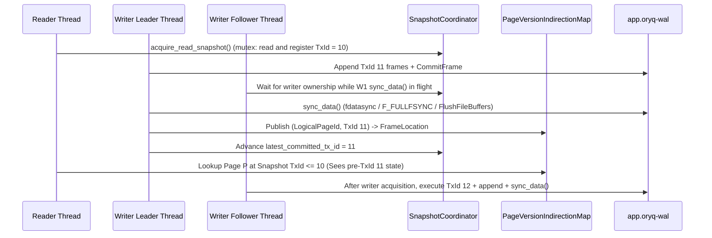

# OryqDB Subsystem Specification: Transactions, MVCC, WAL & Crash Recovery

* **Author:** Ayesh Rodrigo (@ayeshrodz, https://github.com/ayeshrodz)
* **Date:** 2026-11-18
* **Master Design Reference:** [docs/designs/oryqdb.md](./designs/oryqdb.md)

* **Last Reviewed:** 2026-11-19

---

> **Source ownership:** [Modular technical specification](designs/modular-architecture.md) and [module catalog](modules/README.md) own crate/file placement and extension boundaries. This subsystem document continues to own its behavioral/byte contract; earlier core-relative module paths map through the new ownership table.

## 1. Purpose

This document defines OryqDB's ACID transaction engine, Snapshot Isolation visibility rules, logical-page Write-Ahead Logging (`.oryq-wal`), serialized durable commits (with later queued-command batching), deterministic crash recovery, checkpointing, online backup, and the dual-mode `SnapshotCoordinator` (default `SingleProcessCoordinator` and proposed extension `SharedShmCoordinator`, disabled until E2).

## 2. Architecture

OryqDB decouples page version visibility from physical B+ tree block allocation by combining **Stable Logical Page IDs** with an append-only **Write-Ahead Log (`.oryq-wal`)** and a lock-free **Page-Version Indirection Map**:

1. **Atomicity & Durability:** All page mutations generated by a `WriteTransaction<'db>` are buffered in transaction-private dirty buffers and written sequentially to `.oryq-wal` as checksummed frames (`FullPageFrame` for the first mutation to a page after a checkpoint, or compact `SlotDeltaFrame` for subsequent slot deltas) terminated by a `CommitFrame`. A transaction is durable and visible if and only if its `CommitFrame` has been written and synchronized to `.oryq-wal` (`fdatasync` on Linux, `fcntl(F_FULLFSYNC)` on macOS, `FlushFileBuffers` on Windows).
2. **Consistency:** Primary-key uniqueness, unique secondary indexes, parallel-array compound index guards, and page checksums are validated inside the write transaction before the `CommitFrame` is emitted. Rollback discards buffered dirty frames and leaves `.oryq-wal` and `PageVersionIndirectionMap` untouched.
3. **Isolation (Snapshot Isolation):** Every `ReadTransaction<'db>` acquires an immutable `snapshot_tx_id: TxId` at start. When resolving any `LogicalPageId`, the reader queries `PageVersionIndirectionMap` for the highest committed version with `tx_id <= snapshot_tx_id`, falling back to the baseline page in `.oryq` if no WAL version exists. Readers and writers can run concurrently; snapshot admission and checkpoint publication use a short coordinator mutex. Page I/O and transaction bodies do not hold that mutex.



## 3. Public Interfaces

```rust
// Illustrative Rust Transaction Interfaces (Design Only)
pub struct ReadTransaction<'db> { /* snapshot_guard: SnapshotGuard<'db> */ }
pub struct WriteTransaction<'db> { /* writer_guard: WriterGuard<'db>, dirty_pages: ... */ }

impl<'db> ReadTransaction<'db> {
    pub fn snapshot_tx_id(&self) -> TxId;
    pub fn collection(&self, name: &str) -> Result<ReadCollection<'_, 'db>, OryqError>;
}

impl<'db> WriteTransaction<'db> {
    pub fn collection(&mut self, name: &str) -> Result<WriteCollection<'_, 'db>, OryqError>;
    pub fn commit(self) -> Result<CommitReceipt, OryqError>;
    pub fn rollback(self) -> Result<(), OryqError>;
}
```

If a `WriteTransaction<'db>` is dropped without calling `commit()`, its `Drop` implementation automatically executes `rollback()`.

## 4. Internal Data Structures

* **`PageVersionIndirectionMap` (`cache/version_map.rs`):** Sharded concurrent map from `LogicalPageId` to a small sorted vector of `(TxId, FrameLocation)`, where `FrameLocation` is either `InBufferPool(FrameIdx)` or `InWal { byte_offset: u64, byte_len: u32, is_delta: bool, base_fpw_offset: u64 }`.
* **`SingleProcessCoordinator` (`transaction/single_process.rs`):**
  * Holds a process-global `(st_dev, st_ino)` handle registry entry and a connection-lifetime exclusive OS advisory file lock on `.oryq`.
  * Tracks `latest_committed_tx_id: AtomicU64` and a fixed array of 64 cache-line-aligned reader epoch slots (`[CachePadded<AtomicU64>; 64]`).
* **`SharedShmCoordinator` (`transaction/shared_shm.rs`, E2 proposed extension; disabled until protocol verification):**
  * Holds a shared OS file lock on `.oryq`, maps `.oryq-shm`, and acquires an exclusive 1-byte OS kernel file lock on byte `16 + slot_idx` of `.oryq-shm` for the connection's lifetime.
  * Accesses all `.oryq-shm` words strictly via `*const AtomicU64` raw pointer intrinsics (`Ordering::Acquire` / `Ordering::Release`).
* **`GroupCommitQueue` (`transaction/group_commit.rs`, E3 proposed optimization):** Queued-command batching per Section 4.2; explicit write transactions do not use prepared-page queues.

### 4.1 Snapshot Admission, Checkpoint & Recovery Protocol

1. **Admission:** Under one coordinator mutex, read `latest_committed_tx_id`, allocate a reader token, and publish its retention pin. Checkpoint captures its horizon under the same mutex. Drop unregisters the token only after its views and page guards are released. This closes the load-before-registration race. The version map includes versioned catalog roots, allocation state and feature masks; a writer reads its private changes before committed state.
2. **Checkpoint:** Hold the writer/checkpoint lock to exclude append and schema changes. Capture committed tail `T` and horizon `H = min(latest_committed, active snapshots)`. Keep the entire WAL cycle; materialize committed page versions through `H` and write them to `.oryq`. Sync `.oryq` data first. Only then write the alternate shadow header (including roots, allocation metadata and `checkpointed_tx_id = H`) and sync again. Never checkpoint transaction-private pages. New readers may register at the current committed snapshot while copying; existing snapshots remain pinned.
3. **Reset:** Passive checkpoints never truncate a prefix. Reset only after a checkpoint through `latest_committed` and, under the admission mutex, confirmation that no snapshots/old-cycle guards remain. Block admission until the new WAL header is synced. Durably publish `reset_intent_seq = current_seq + 1` in **both** main-header slots (separate increasing generations, sync each) before changing the WAL, so either surviving slot proves reset intent. Increment the checkpoint sequence and salts; `set_len(64)` removes the entire old frame suffix, write the new header, then sync both header and file-length change, then durably clear the intent in **both** header slots (sync each) before reopening admission. Both slots must describe the fully checkpointed roots/horizon before old WAL is discarded. The final headers set `checkpointed_wal_seq` to the new WAL sequence and `wal_required=0` (sealed). Validate WAL sequence equality on open except while completing a recorded reset intent. A crash after database-header sync but during reset is recoverable from the fully checkpointed main file. When the selected valid main header has nonzero `reset_intent_seq`, all committed state is already in `.oryq`; complete the reset to that sequence with no transaction replay and clear the intent durably. Without this marker, `wal_required=1` plus a missing/torn WAL is `Corruption`. A sealed `wal_required=0` database may have no WAL; create and sync an empty one with the recorded sequence before writing. A present invalid WAL without reset intent still fails closed.
4. **Recovery:** With exclusive recovery ownership, scan the current UUID/sequence and checksum chain in order. Apply complete transactions only; reconstruct each delta from its committed FPW baseline. Retain committed frames until database pages and the new shadow header are durably synced. Recovery itself is restartable using the same WAL. An incomplete final frame/transaction is an uncommitted tail. A checksum-invalid complete frame is corruption, not permission to silently discard later acknowledged commits. Report corruption and retain artifacts for diagnosis.
5. **Publication:** After successful WAL sync, install all version-map entries before publishing `latest_committed_tx_id` with release ordering. Snapshot acquisition observes this state under the admission mutex. A publication failure poisons the database and requires recovery, just like an uncertain sync.
6. **Backup:** `backup_to()` holds a read snapshot, resolves every live catalog/data/index/overflow page at that snapshot, writes a fresh standalone target with consistent roots and UUID metadata, syncs data and headers, verifies integrity, then publishes the destination. Refuse source/destination identity equality. Delete incomplete temporary output on failure; never expose a partially successful backup.

### 4.1.1 Sealed Files & First Write

Creation, standalone backup, and a completed full checkpoint/reset produce `wal_required=0`. Only this durable sealed state permits a main-only copy or a missing-WAL open. Before the first post-seal transaction can append frames, hold the writer lock, create/sync the WAL header and directory entry if needed, and durably publish `wal_required=1` in **both** main-header slots (sync each). Only then append any mutation/commit frames. A crash while unsealing cannot lose acknowledged transactions because no append is allowed until both header writes complete. Never clear the flag during a partial checkpoint. Backup sets it to 0 after all copied pages/roots are synced; callers can copy that single output file safely.

### 4.2 Writer Serialization & Group Commit Boundary

An explicit `WriteTransaction` owns the logical writer lock from begin through WAL sync/publication; its body sees the latest committed state plus its own writes. It performs one sync per commit. Prepared dirty pages from independently started transactions must never be blindly queued.

Group commit is an optional later optimization for queued **write commands**, not independently prepared page images. Under the same writer lock, a leader executes commands serially against a private batch view including preceding commands, validates each statement, emits contiguous transactions and commit markers, syncs once, then publishes the entire successful batch in order. No queued caller is acknowledged before sync; any sync failure poisons all dependent batch results. Explicit transactions keep the baseline path. Enable the optimization only after conflict, uniqueness, rollback, partial-batch failure and durability tests; baseline correctness does not depend on batching.

## 5. Invariants

1. **Write-Ahead Rule:** No modified page may be written to the main `.oryq` file until its corresponding WAL transaction has been committed and synced to `.oryq-wal`, and the checkpoint horizon is at or below every registered reader snapshot. WAL reset additionally requires no active snapshots or page guards from the old cycle.
2. **Torn-Page Immunity (Full-Page Write Baseline):** The first modification to any `LogicalPageId` after a checkpoint must emit a `FullPageFrame` (`0x01`) containing the complete 8192-byte page image before subsequent mutations in the same WAL cycle may emit `SlotDeltaFrame` (`0x02`) records.
3. **Chained Checksum Continuity:** Every frame in `.oryq-wal` chains its `cumulative_checksum` from the preceding frame using the WAL header's `(salt1, salt2)` pair. A single corrupted or stale sector invalidates all subsequent frames.
4. **POSIX Inode Lock Safety:** Within a single OS process, `Database::open()` consults the process-global `(st_dev, st_ino)` registry before opening or closing any file descriptor, ensuring a second `open()` call in the same process never closes a descriptor that would cause the POSIX kernel to drop active `fcntl` locks.

## 6. Error Handling

* **Interrupted Commits:** During recovery, any transaction whose frames are not followed by a valid `CommitFrame` with a matching chained checksum is discarded, and `.oryq-wal` is truncated to the end of the last valid `CommitFrame`.
* **Stalled Reader Horizon:** Crossing the 128 MiB WAL target and 300s snapshot age requests cancellation. The next operation returns `SnapshotTooOld`, but cancellation does not remove the retention pin until the transaction and all outstanding views/guards are released. At `max_wal_hard_bytes` (default 256 MiB), reject a write whose projected encoded WAL size crosses the limit with `WalLimitExceeded`; never reclaim live reader storage to make space.
* **Failed WAL Write or Sync:** A commit write/sync error can have an indeterminate durable outcome. Return `CommitOutcomeUnknown`, poison the database for further operations, and require close/reopen recovery. Do not report rollback or reuse the tail after a failed sync. Recovery may retain a complete valid commit whose caller received an error; applications use stable `_id`/operation IDs to retry idempotently.

## 7. Concurrency Behavior

* **Readers:** In `SingleProcess`, register each transaction under the coordinator mutex before releasing its snapshot to the caller; multiple nested transactions on one thread have distinct slots. Capacity exhaustion returns `TooManyReaders` rather than overwriting a live slot. Shared-process admission follows the extension protocol in Section 4.1; it has no zero-syscall guarantee.
* **Writers:** Serialized explicit transaction execution through sync/publication. E3 queued-command batching has separate dependency and failure tests.
* **Dead-Process Recovery in `.oryq-shm`:** When a process is killed via `SIGKILL`, the OS kernel releases its 1-byte file lock at offset `16 + slot_idx` in `.oryq-shm`. Any peer process detecting a stale snapshot or writer lock probes that 1-byte kernel lock with `try_lock_byte_range`; upon acquiring the lock, it clears the dead slot and recovers the WAL tail.

## 8. Performance Characteristics

* **Single-Threaded Commit Latency:** Zero group-commit timer delay; latency equals 1 sequential WAL write + 1 `fdatasync` syscall.
* **Multi-Threaded Commit Throughput:** Baseline explicit transactions use one sync each. E3 aims to amortize flushes for queued commands; throughput is unmeasured.
* **Snapshot Read Overhead:** Short mutex-protected registration plus a page-map lookup and version selection; costs depend on retained versions, and must be measured.

Version-map entries, frame offsets and allocation metadata count against `max_cache_bytes`; evict metadata as well as pages and reconstruct version locations by scanning the retained WAL when needed. A fixed-size latest-only cache is an optimization, never historical truth. Before allocating a dirty page, charge the transaction budget; all size arithmetic is checked.

## 9. Known Limitations

* Write transactions are serialized at the database level; workloads requiring independent multi-writer disk saturation should partition collections across separate `.oryq` files.
* Network filesystems (NFSv3, SMB without strict byte-range lock coherence) are not supported for `SharedMultiProcess` mode.

## 10. Testing Methodology

* **7-Point Deterministic Fault Injection (`tests/recovery/crash_fault_injection.rs`):** Uses `FaultInjectingStorageIo` and a subprocess crash harness to terminate execution at all 7 critical points required by [docs/draft-spec.md](draft-spec.md):
  1. Before a transaction begins.
  2. During data-page modification in memory.
  3. Mid-stream during `.oryq-wal` frame writing.
  4. Immediately before writing `CommitFrame`.
  5. Immediately after `CommitFrame` sync.
  6. Mid-checkpoint while copying WAL pages to `.oryq` and updating Page 0 shadow headers.
  7. Mid-recovery during `Database::open()`.
* **Subprocess `SIGKILL` `.oryq-shm` Test:** Spawns child processes holding active reader and writer slots in `.oryq-shm`, sends `SIGKILL` at random points, and verifies that surviving processes reclaim the dead slots and verify database integrity via `oryq integrity-check`.

* **Adversarial schedule gates:** Pause before/after admission, during WAL I/O, with outstanding views at cancellation, and at each checkpoint/reset write/sync (including each shadow slot). Reopen twice after each crash; test failed-sync uncertainty and hard-cap rejection. Verify exact committed document/index state, not merely successful open.
